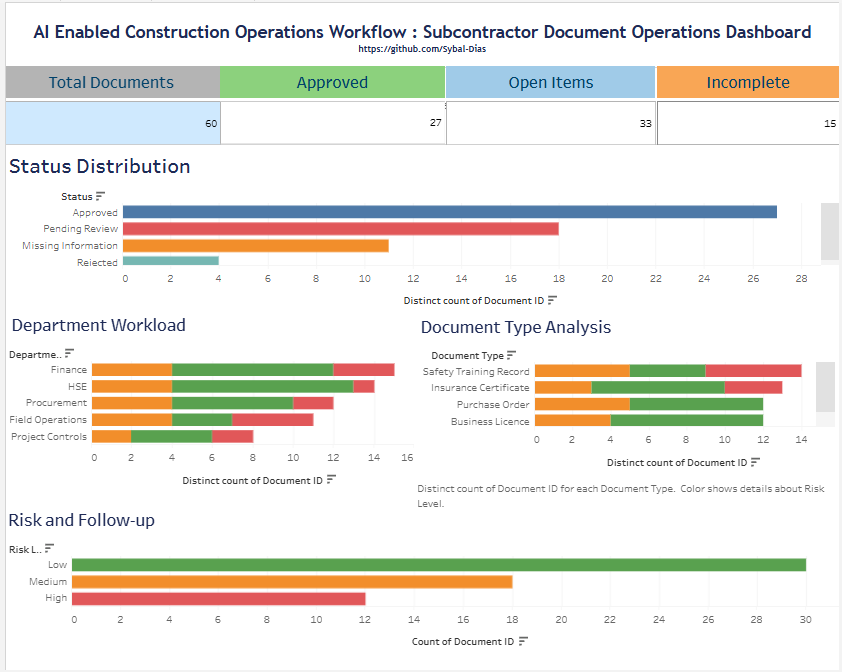

# AI-Enabled Construction Operations Workflow
### Subcontractor Document Intake, Classification & Approval Tracking

**Independent Portfolio Project | Business Analysis | AI Enablement | Tableau | Process Improvement**

## Project Overview

This project demonstrates how AI-assisted document processing, business process redesign and operational analytics could improve subcontractor document intake and approval tracking in a hypothetical construction organization.

The project focuses on identifying administrative bottlenecks, designing improved workflows, introducing human-supervised AI assistance and developing a Tableau dashboard for operational monitoring.

**Project status:** Independent portfolio prototype  
**Dataset:** 60 synthetic records  
**Tools:** Tableau, Excel/CSV, Generative AI, Business Process Analysis  
**Industry:** Construction operations (simulated scenario)
**Project Folder Structure:**

## Business Problem

Construction organizations may manage subcontractor documentation through emails, spreadsheets and manual follow-ups.

This can result in:

- Repetitive manual document classification.
- Incomplete submissions.
- Delayed identification of missing information.
- Repeated administrative follow-ups.
- Limited visibility into outstanding approvals.
- Time-consuming management reporting.

The objective is to propose a more structured and measurable document-management workflow.

## Project Objectives

1. Standardize document intake and tracking.
2. Identify incomplete submissions.
3. Introduce AI-assisted document classification.
4. Retain human oversight for exceptions and approval decisions.
5. Improve operational visibility through Tableau.
6. Translate business needs into requirements and acceptance criteria.
AI is used as an administrative assistant, not as an independent compliance or safety decision-maker.

## Tableau Dashboard
 

### Key Performance Indicators

| KPI | Purpose |
|---|---|
| Total Documents | Overall submission volume |
| Approved Documents | Completed approvals |
| Open Documents | Items not yet approved |
| Incomplete Documents | Submissions requiring additional information |
| Approval Rate | Proportion of approved records |
| Average Processing Days | Average processing time for approved records |

All results are based on synthetic demonstration data.

## AI Enablement

An AI-assisted document classification prompt was designed to extract:
- Document type.
- Subcontractor information.
- Issue and expiry dates.
- Missing fields.
- Potential inconsistencies.
- Suggested review department.
- Human-review requirements.

The AI prototype uses a human-in-the-loop approach. All compliance-sensitive decisions remain with authorized personnel.

## Business Analysis Deliverables

- Business problem statement.
- Stakeholder analysis.
- AS-IS and TO-BE process descriptions.
- Business requirements.
- User stories.
- Acceptance criteria.
- Risk assessment.
- User acceptance testing scenarios.
- Change management and training plan.

## Business Value

The proposed solution aims to improve:

- Document status visibility.
- Exception identification.
- Administrative consistency.
- Departmental coordination.
- Management reporting.
- Responsible AI adoption.

Actual time savings and operational improvements have not been measured. A real implementation would require a baseline, pilot testing and validated performance data.

## Technology and Skills Demonstrated

**Business Analysis:** Requirements definition, stakeholder analysis, process improvement, user stories and UAT.

**AI Enablement:** Prompt design, information extraction, human-in-the-loop controls and responsible AI.

**Data Analytics:** Synthetic dataset preparation, KPI development and operational reporting.

**Business Intelligence:** Tableau dashboard development and data visualization.

**Communication:** Technical documentation, user guidance and change management.

## Limitations and Future Development

This is a time-boxed independent portfolio prototype. It does not represent a production implementation.

Future enhancements could include:

- Microsoft Power Automate integration.
- SharePoint document management.
- Automated notification workflows.
- OCR-based document extraction.
- Role-based access controls.
- Audit logging.
- User adoption and performance measurement.

## Disclaimer

This project is independently developed for educational and professional portfolio purposes.

All data is synthetic. No actual subcontractor, employee, company or confidential business information is included.

The project is not affiliated with or implemented for Morgan Construction or any other construction organization.
